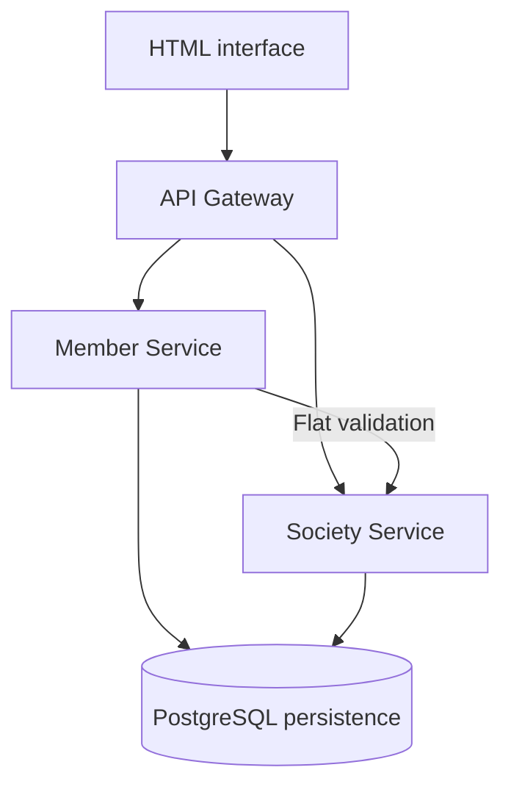

# Emerald Housing

**Members, homes and society operations—connected through a service-based Java application.**


Emerald Housing is a housing society management project with dedicated Member and Society services behind an API Gateway. It brings together member records, flats, floors and memberships, with backend support for scoped permissions, auditing, search and concurrent updates.

[Features](#features) · [Architecture](#architecture) · [Build and tests](#build-and-tests) · [API guide](#api-guide) · [Repository map](#repository-map) · [Deployment resources](#deployment-resources)

## Features

| Area | Backend capabilities |
| --- | --- |
| Society operations | Society, floor and flat information |
| Member management | Member records, memberships and account mappings |
| Scoped access | Administrator, society administrator, committee and resident roles |
| Audit history | Transactional audit events for business and permission changes |
| Search and navigation | Server-side filters, page-number queries and cursor pagination |
| Concurrent updates | JPA versioning and ETag-based conditional writes |
| Integration checks | Shared consumer/provider contract fixtures |

> **Current scope:** the documented deployment serves one society, **EMERALD**. It is not a multi-tenant schema. Account management, audit history, server search and conditional updates are documented backend features; existing frontend screens do not yet expose all of them.

## Architecture



This is a logical overview; PostgreSQL database settings and deployment topology are defined by each service and its manifests.

| Component | Responsibility |
| --- | --- |
| [API Gateway](infrastructure/api-gateway) | API entry point, routing and session/account permission validation |
| [Member Service](services/member-service) | Members, memberships, application accounts and related auditing |
| [Society Service](services/society-service) | Society, floor and flat information, with flat auditing |
| PostgreSQL and Flyway | Relational persistence and versioned database migrations |
| Redis | Session/cache and coordination mechanisms described in the backend guide |
| [HTML interfaces](indexLatest.html) | Checked-in browser interface; an [additional interface file](index.html) is also included |

Backend services independently validate sessions and enforce record-level permissions. See the [access and query guide](docs/backend-access-and-query-features.md) for the precise behavior and limitations.

## Build and tests

### Prerequisites

- JDK 21 and Git.
- Network access for Maven dependencies and the wrapper distribution.
- Docker running for Testcontainers PostgreSQL integration tests.
- Kubernetes and kubectl when exploring the deployment manifests.

```bash
git clone https://github.com/devendraghag/emerald-housing.git
cd emerald-housing
java -version
```

### Build a service

The repository contains separate Maven applications. For example, build Society Service from its own directory.

**Windows PowerShell**

```powershell
cd services/society-service
.\mvnw.cmd clean package
```

**macOS / Linux**

```bash
cd services/society-service
sh mvnw clean package
```

A successful build packages the service; it does not provision PostgreSQL, Redis or a running deployment. Review the service configuration and Kubernetes resources before starting the application.

### Verify service contracts

From the repository root on Windows:

```powershell
powershell.exe -NoProfile -ExecutionPolicy Bypass -File .\scripts\test-contracts.ps1
```

The script runs Member consumer and Society provider checks against the shared [flat-service contract](contracts/member-to-society-flat-v1.json). No separately hosted contract broker is required.

PostgreSQL integration tests cover migrations, scoped search, cursor continuation, audit rollback and concurrent entity updates. These tests require Docker; the backend guide notes that Testcontainers tests are skipped when Docker is unavailable. A skipped integration test is not evidence of a passing database integration.

## API guide

The existing [backend access and query documentation](docs/backend-access-and-query-features.md) explains authentication context, request examples, response behavior and operational caveats.

| Workflow | Example route |
| --- | --- |
| Create an application account | `POST /api/v1/accounts` |
| Update account permissions | `PUT /api/v1/accounts/{accountId}/permissions` |
| Search members | `GET /api/v1/members/page?search=asha&status=ACTIVE&page=0&size=20` |
| Browse flats with a cursor | `GET /api/v1/flats/cursor?limit=20&floorNumber=1` |
| Read member audit history | `GET /api/v1/members/audit?entityType=MEMBER&limit=50` |
| Read an individual flat | `GET /api/v1/flats/{flatId}` |

These routes require the appropriate authenticated session and permissions. Mutation requests use the existing CSRF protection. For conditional member/flat updates, retrieve the current ETag and send it with `If-Match`; see the guide for compatibility settings and conflict responses.

## Repository map

| Path | What to explore |
| --- | --- |
| [services/](services) | Member and Society backend applications |
| [infrastructure/api-gateway/](infrastructure/api-gateway) | Gateway application |
| [contracts/](contracts) | Shared service contract fixtures |
| [docs/](docs) | Backend feature and Java language documentation |
| [postman/](postman) | API exploration resources |
| [kubernetes/](kubernetes) | Deployment configuration |
| [kubernetes-canary/](kubernetes-canary) | Canary deployment resources |
| [kubernetes-observability/](kubernetes-observability) | Observability resources |
| [scripts/](scripts) | Contract, canary and operational helpers |

## Deployment resources

The repository includes Dockerfiles, Kubernetes manifests, canary validation/rollback helpers and observability resources. Review their environment-specific values and required secrets before deployment.

For changes affecting session representations or internal authorization, the backend guide calls for compatible Gateway and backend versions and a fresh sign-in after deployment. Keep internal service endpoints within the trusted service path.

## Explore the engineering

- **Authorization:** follow how account permissions become scoped backend access.
- **Consistency:** examine transactional auditing and optimistic concurrency control.
- **Service boundaries:** compare the shared contract with consumer/provider verification.
- **Operations:** inspect the separation of core deployment, canary and observability resources.

Start with the [backend feature guide](docs/backend-access-and-query-features.md), then review the [Java language feature notes](docs/java-language-features.md) and service source.
